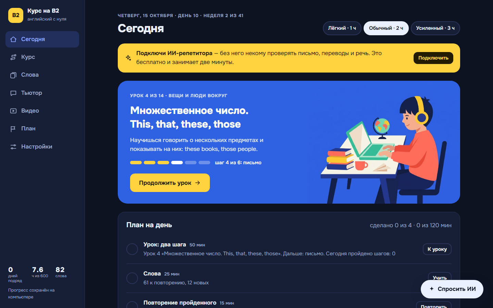
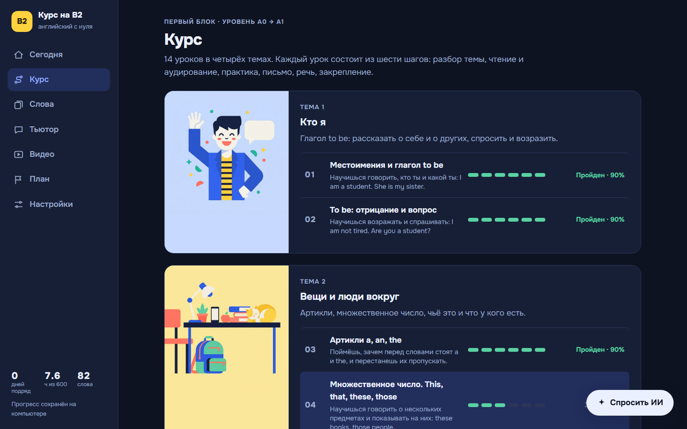
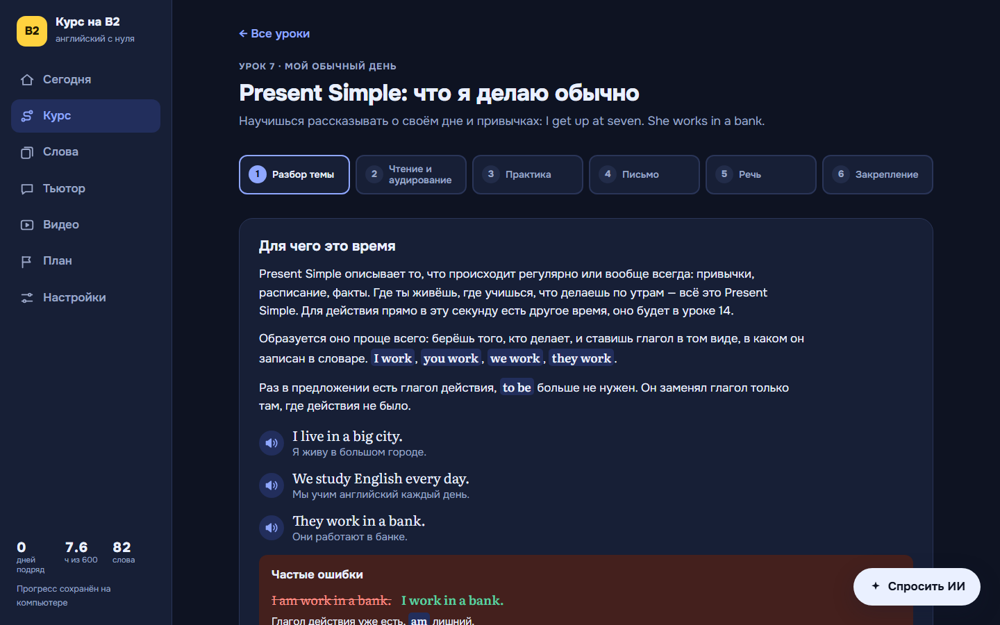
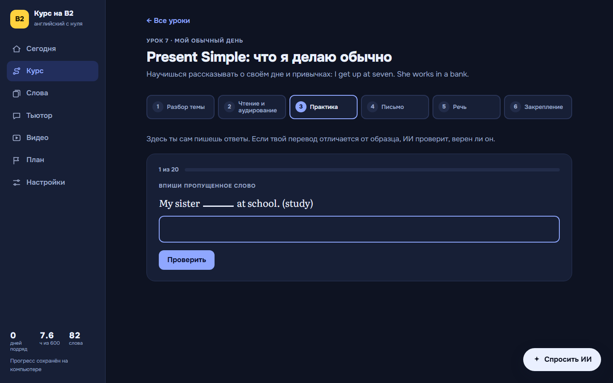
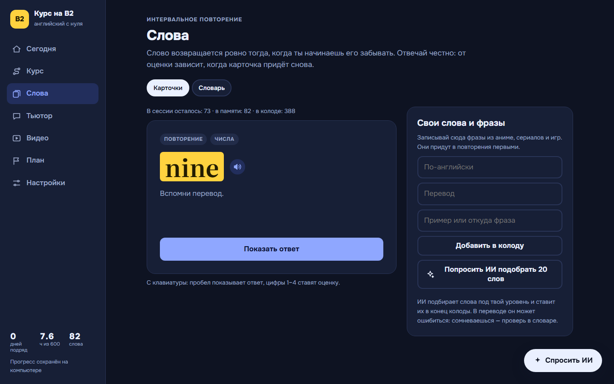
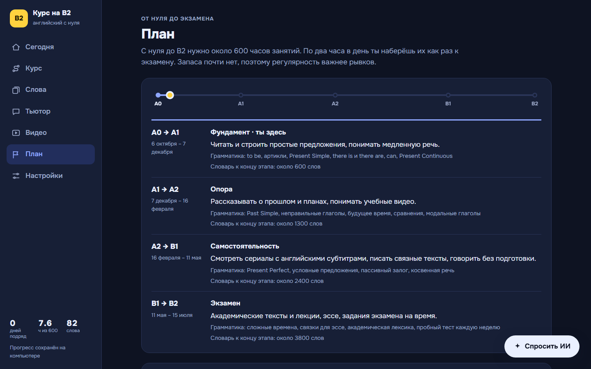
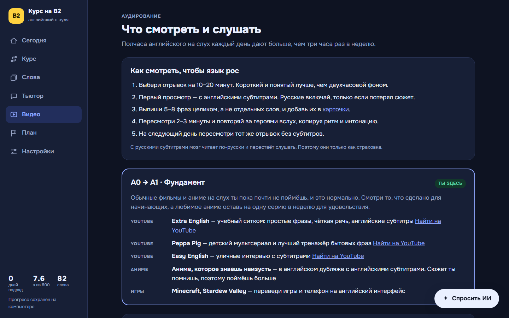
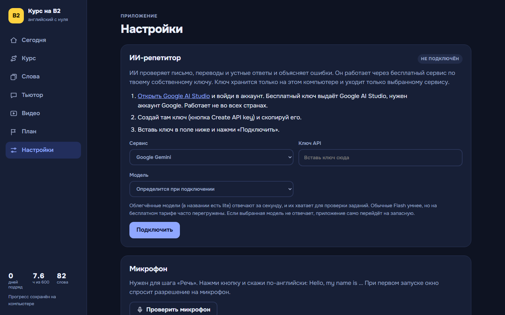

# Курс на B2

Настольное приложение, чтобы выучить английский с нуля до уровня B2. Внутри курс, словарь с интервальным повторением, план до экзамена и ИИ-репетитор, который проверяет письмо, переводы и речь.



## Что внутри

- **Курс.** 14 уроков в 4 юнитах (уровень A0 → A1). Каждый урок состоит из шести шагов: разбор темы, чтение и аудирование, практика, письмо, речь, закрепление.
- **Практика.** 282 задания четырёх видов: вписать слово, собрать предложение, перевести, исправить ошибку. Плюс 84 вопроса итоговых тестов.
- **Слова.** 360 встроенных слов и свои карточки. Интервальное повторение: приложение само решает, что повторить сегодня.
- **Повторение уроков** через 1, 3, 7, 16 и 35 дней после прохождения.
- **План от A0 до B2:** 4 этапа, около 600 часов, дата экзамена и три режима нагрузки (1, 2 или 3 часа в день). Каждый день приложение собирает план и считает время.
- **Видео для аудирования** со ссылками на поиск в YouTube.
- **Озвучка и речь.** Любую английскую фразу можно прослушать, обычно или медленно. На шаге «Речь» ответ говорится в микрофон и распознаётся.

## ИИ-репетитор

- Проверяет перевод или исправление, когда ответ не совпал с образцом, но может быть верным.
- Объясняет ошибки.
- Разбирает письменные тексты и устные ответы.
- Чат-тьютор и кнопка «Спросить ИИ» на любом экране с контекстом текущего урока.

**Провайдеры на выбор:** Google Gemini, Groq, OpenRouter, Ollama на своём компьютере или любой сервис с OpenAI-совместимым API. Для Gemini приложение само выбирает модель, а если она перегружена, переключается на следующую по цепочке.

Ключ хранится только на компьютере пользователя и уходит только выбранному сервису.

## Как устроено

- **Python без сторонних пакетов.** Локальный сервер на `http.server`, интерфейс на HTML, CSS и JavaScript без фреймворков. Окно приложения — Edge или Chrome в режиме приложения.
- **Безопасность.** Сервер слушает только `127.0.0.1` и отвечает только своему окну (проверка Host и Origin плюс служебный заголовок). Чужой сайт, открытый в браузере, не прочитает ни прогресс, ни ключ.
- **Надёжность:**
  - запись через временный файл с заменой: сбой посреди сохранения не портит прогресс;
  - ежедневная копия прогресса, хранятся 30 дней;
  - повторный запуск открывает окно уже работающего приложения;
  - сервер сам выключается, когда окно закрыто.
- **Проверка контента.** `node tools/check_content.js` до запуска ловит ошибки в уроках: пропущенные поля, неверные индексы, ответы, которые не проходят собственную проверку.

## Запуск

Нужен Python 3.8+. Приложение сделано под Windows; на других системах откроется в браузере по умолчанию.

```
python app.py
```

Ярлык на рабочем столе: `python make_shortcut.py`. Дальше приложение запускается без окна консоли через `KursB2.pyw`.

Прогресс и настройки ИИ лежат в папке `data/` рядом с приложением. В репозиторий она не попадает.

## Скриншоты

| | |
|---|---|
|  |  |
|  |  |
|  |  |
|  | |

## Структура

```
app.py              локальный сервер, хранение прогресса, запуск окна
KursB2.pyw          запуск без консоли
make_shortcut.py    ярлык на рабочем столе
index.html          каркас интерфейса
static/core.js      состояние, план, интервалы повторения
static/views.js     экраны: Сегодня, Курс, Слова, Тьютор, Видео, План, Настройки
static/lesson.js    шаги урока
static/ai.js        провайдеры ИИ, выбор модели, проверки
static/speech.js    озвучка и распознавание речи
static/content/     уроки и словарь
tools/              проверка контента и запуска
```

## Как сделано

Приложение сделано в режиме вайбкодинга. Задачу, требования, проверку и решения по продукту определял я, код писался вместе с Claude Code. Пользуюсь им сам каждый день: готовлюсь к экзамену.

Автор — Кирилл Гарбуков.
